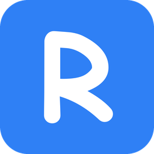
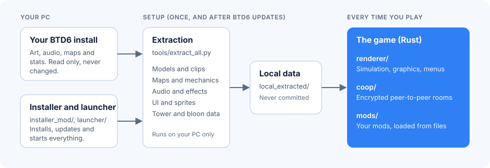

<p align="center">
  
</p>

<h1 align="center">RustTD6</h1>

<p align="center">
  <strong>Bloons TD 6 on a new engine, written from scratch in Rust.</strong><br>
  Free and fan-made. Bring your own copy of the game.
</p>

<p align="center">
  <a href="https://rusttd6.com">Website</a> ·
  <a href="https://github.com/blinkywink/rrbtd6/releases/latest">Download</a> ·
  <a href="https://rusttd6.com/docs/">Mod API</a> ·
  <a href="docs/README.md">Documentation</a>
</p>

> **This repository contains code only.** It ships no Ninja Kiwi art, audio, maps or game data.
> Everything the game needs is extracted on your own PC from your own legitimately owned copy of
> Bloons TD 6, and nothing extracted from the game is ever committed or redistributed.
> RustTD6 is an unofficial project, not affiliated with or endorsed by Ninja Kiwi.

## What it is

RustTD6 aims to play identically to the original, apart from the changes listed in
[docs/DEVIATIONS.md](docs/DEVIATIONS.md). Mechanics are read from the original game's own logic,
then recorded in BTD6 and compared frame by frame.

- **Everything unlocked:** every tower, upgrade and hero from the start, with no account needed.
- **Co-op:** private, encrypted peer-to-peer rooms. A host can share their mods with the room.
- **Mods:** new towers, bloons, modes, UI and custom models. See the [Mod API docs](https://rusttd6.com/docs/).
- **Your settings:** render scale, sharpening, anti-aliasing, VSync, an FPS limit and a tidier HUD.
- **Your data stays yours:** it never changes BTD6, your save or your account.

The project is early. Towers are matched one at a time; [docs/dev/TOWERS.md](docs/dev/TOWERS.md)
has the checklist.

## Installing (players)

1. Own Bloons TD 6 on PC and install [MelonLoader 0.7.3](https://github.com/LavaGang/MelonLoader/releases/tag/v0.7.3) into it.
2. Download `RRBTD6Installer.dll` from the [latest release](https://github.com/blinkywink/rrbtd6/releases/latest)
   and put it in BTD6's `Mods` folder.
3. Start BTD6. At the main menu it offers to install RustTD6: pick a folder.
4. The launcher (`rrbtd6-launcher.exe`, also on your desktop if you ask for a shortcut) downloads
   the game, sets up a private Python, extracts the art and data from your BTD6 install and starts it.

The first setup is the slow part, and it uses a lot of memory and CPU while it runs, so it goes
faster with other programs closed. Start RustTD6 from the launcher from then on: it updates itself
and the game every time, and extracts again after BTD6 updates.

The installer and launcher only contact GitHub, python.org and PyPI. They never contact Ninja Kiwi.

## How it works

<p align="center">
  
</p>

| Folder | What's in it |
|---|---|
| [`renderer/`](renderer/README.md) | The playable game: simulation, graphics, menus and audio (macroquad) |
| [`engine/`](engine/README.md) | An earlier headless simulation core, used by the benchmarks and compatibility tests, not the game |
| [`coop/`](coop/README.md) | Peer-to-peer co-op |
| [`launcher/`](launcher/README.md), [`installer_mod/`](installer_mod/README.md) | Windows launcher and the MelonLoader installer mod |
| [`tools/`](tools/README.md) | Asset extraction from a local BTD6 install, build scripts and research helpers |
| [`mods/`](mods/README.md) | The mod API reference and an example mod |
| [`website/`](website/README.md) | The static [rusttd6.com](https://rusttd6.com) site and mod docs |
| [`research/`](research/) | Notes on the original game's formats and behaviour |
| [`benchmarks/`](benchmarks/README.md), `tests/`, `specs/` | Performance runs, conformance tests and compatibility notes |
| `vendor/` | Third-party code carried with local changes |

## Building (developers)

You need [Rust](https://rustup.rs), Python 3 and Bloons TD 6 on Windows.

1. Install Bloons TD 6 and MelonLoader, and run the game once.
2. Extract the game data from your install:

   ```sh
   BTD6_DIR="<BTD6 folder>" sh tools/build_local_assets.sh
   ```

3. Build, then run `BTD6.exe`:

   ```sh
   sh tools/build_exe.sh
   ```

Run the tests with `cargo test -p btd6-game` and `python -I tools/tests/test_<name>.py`.
See [CONTRIBUTING.md](CONTRIBUTING.md) before opening a pull request.

### macOS (personal builds)

The game data still comes from a Windows install: copy its `local_extracted` folder to the Mac.
Then, with the Xcode command line tools and [Rust](https://rustup.rs) installed, from this checkout:

```sh
sh tools/build_macos.sh path/to/local_extracted
```

This builds `RustTD6.app` here (git-ignored) with the game's data inside it (about 3 GB);
add `--link` to link to the data folder instead. A crash leaves its reason in
`~/RustTD6-crash.log`.

### Linux (personal builds)

Copy `local_extracted` from a Windows install into this checkout, install Rust and the X11 /
OpenGL / ALSA development packages (listed in the script), then run `sh tools/build_linux.sh`
and start `./RustTD6-linux`.

macOS and Linux builds are for personal use and aren't distributed.

## License

The code in this repository is available under the [MIT License](LICENSE). The license doesn't
cover Bloons TD 6 or anything extracted from it, which remain the property of Ninja Kiwi. Code in
`vendor/` and the fonts in `website/public/fonts/` keep their own licenses.
